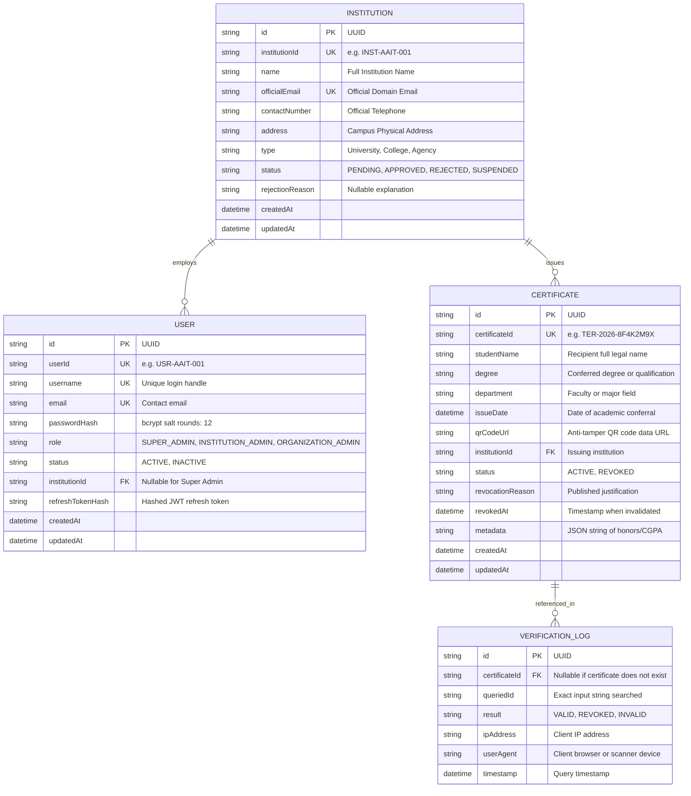

# TerAuth Database Schema & Architecture

TerAuth uses a relational database schema managed through **Prisma ORM**. The platform supports both **PostgreSQL** (production deployment) and **SQLite** (instant zero-configuration local development/evaluation).

---

## Entity Relationship Overview



---

## Key Constraints & Security Rules

1. **Unique Constraints**:
   - `Institution.institutionId` & `Institution.officialEmail`
   - `User.userId`, `User.username`, & `User.email`
   - `Certificate.certificateId`: Strictly non-sequential cryptographically generated identifiers (`TER-YYYY-XXXXXXXX`).
2. **Foreign Key Integrity**:
   - Deleting an institution cascades to certificates.
   - Deleting a certificate sets `certificateId` on existing verification logs to `NULL` to preserve immutable audit history.
3. **Data Protection**:
   - Plaintext passwords and secret tokens are never stored. Passwords use `bcryptjs` with salt rounds 12.
   - Database internal UUIDs and user hashes are never exposed in public verification endpoints.

---

## Production Database Operations & Migration Guide

In development, schemas may be synced via `npm run prisma:push`. However, in production, schema updates **must never** use `db push --accept-data-loss`.

### Standard Production Deployment Steps:
1. Switch active schema to PostgreSQL:
   ```bash
   npm run db:use-postgres
   ```
2. Check pending migrations status:
   ```bash
   npm run prisma:migrate:status
   ```
3. Apply version-controlled migration files safely:
   ```bash
   npm run prisma:migrate:deploy
   ```
4. (Optional) Run database seeder for initial administrative accounts:
   ```bash
   npm run prisma:seed
   ```

### Automated Backup Recommendation:
Configure daily `pg_dump` backups for the PostgreSQL database:
```bash
pg_dump -U postgres -d terauth -Fc -f "/backups/terauth-$(date +%Y%m%d%H%M%S).dump"
```
